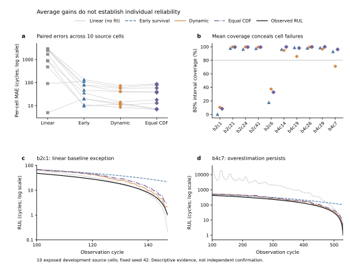

# 动态RUL更新的点误差与个体风险权衡：实验结果及局限草稿
版本：2026-10-19 v3。**开发实验草稿；不是独立确认、正式方法复现或可投稿完成稿。**
本节仅归纳已经完成的实验，不据写作新增训练或改变选择规则。

## 1 实验范围与评价口径
数据来自已保存的MATR原始来源记录batch2/4，经DataV1形成因果前缀。事件定义为放电容量首次实际达到或低于0.88Ah，即名义1.1Ah的80%；SOH=容量/1.1Ah。采用实际循环号，RUL=首次事件循环−当前循环。只在预测时已完成的循环上构造当前SOH及过去固定20循环Theil–Sen速率，归一化与可拟合处理不得使用开发或未来信息。该实验假设完整循环容量可测，不是仅凭在线I/V信号的部署验证。
按来源电池ID先拆分：42fit、22,281个训练前缀；10cal、4,567个评价前缀，origin从100至首次事件前一循环。10cal虽沿用cal命名，已经反复参与研究开发，本节统一视为开发集。另18dev不在本节运行中读取，也不能据此称为全新独立确认集。更早52/19 processed-source实验与本节原始来源42/10协议不同，指标不能直接并表比较。
点模型采用固定seed42的HistGradientBoosting，目标log RUL；150轮、learning_rate0.05、最多7叶/深度3、min_samples_leaf50、L2=1、禁用early stopping。当前模型输入为age、SOH、robust20及可逆静态充电schedule的4电流/3SOC切点。静态schedule在本实验中预先已知；不能推广为未来未知工况。模型训练使每cell总权重相同。
主表所有指标均先在每cell全部可用前缀上平均，再对10cell等权；TimeMAE=(1/10)Σ_b(1/n_b)Σ_s|Rhat_bs−R_bs|。因此覆盖率与严重高估比例是cell宏平均，不是将4,567行混在一起的比例。严重高估定义为预测中位RUL−真实RUL>100循环。80%区间报告覆盖率、平均宽度、interval score；Brier_h针对1{RUL≤h}，h=100/300。这是事件已观测子集的事后评分，不是处理右删失后的总体生存评价。

## 2 三个同前缀分布参考
在相同4,567前缀和相同点模型输出上比较：
- **早期存活参考**：以cycle100预测的RUL分布为起点，之后只按仍存活条件化。若d=s−100，其剩余生存函数为S_100(d+r)/S_100(d)。它没有吸收之后的新容量测量。
- **逐时动态参考**：在每个s使用当时因果特征预测mu_s，构造LogNormal(mu_s,sigma²)。
- **固定等权CDF参考**：F_mix(r)=0.5F_surv(r)+0.5F_dynamic(r)，通过真实混合CDF求q0.1/q0.5/q0.9，不平均分位数。
所有分布沿用既有sigma=0.1989831165；该尺度来自较早3state模型的fit残差，并非新lossless模型的独立校准。本节概率结果必须按这一固定尺度的参考诊断解读。等权在本次混合计算前冻结，没有搜索，但计算发生在已观察两成分结果之后，仍属自适应开发。普通混合不作为新方法主张。

表1 同前缀主结果（所有指标为10cell宏平均）

|方法|TimeMAE/cycle|严重高估>100|80%覆盖|宽度/cycle|IS80|Brier100|Brier300|
|---|---:|---:|---:|---:|---:|---:|---:|
|早期存活|55.2421|0.2791%|79.2520%|205.7845|266.3179|0.082113|0.079738|
|逐时动态|33.0272|3.1631%|79.4309%|116.6688|149.8734|0.013910|0.056527|
|固定等权CDF|35.4520|0.6047%|83.3103%|176.2127|209.4959|0.034196|0.063121|

表2 逐来源电池结果（同一cell各臂前缀完全相同）

|来源ID|前缀数|早期MAE|动态MAE|混合MAE|混合80%覆盖|混合严重高估|
|---|---:|---:|---:|---:|---:|---:|
|MATR_b2c1|48|20.397|10.699|13.048|8.333%|0.000%|
|MATR_b2c21|389|10.839|8.538|6.977|99.486%|0.000%|
|MATR_b2c24|395|35.519|14.182|18.056|99.494%|0.000%|
|MATR_b2c41|329|9.692|11.822|7.022|99.392%|0.000%|
|MATR_b2c6|411|113.850|61.358|79.013|32.847%|0.000%|
|MATR_b4c14|508|47.485|40.510|37.012|99.803%|0.000%|
|MATR_b4c19|892|135.262|73.737|87.589|98.094%|0.000%|
|MATR_b4c26|377|19.642|12.702|7.209|99.735%|0.000%|
|MATR_b4c29|788|78.138|41.011|40.274|99.873%|0.000%|
|MATR_b4c7|430|81.598|55.713|58.320|96.047%|6.047%|

## 3 点精度与严重高估之间存在权衡
纯动态相对早期存活的TimeMAE由55.242降至33.027循环，改善40.2137%，但宏平均严重高估比例从0.2791%升至3.1631%，增加2.8840个百分点，超过原冻结的+1个百分点护栏。较好的均值精度不能据此解释为每颗目标电池都更可靠。
固定等权CDF的TimeMAE为35.452循环，相对早期存活改善35.8243%，10/10cell均改善；配对cell重采样2,000次、seed42得到MAE差95%区间[11.1077,28.7852]循环。该区间只反映这10个开发来源ID的重采样，不消除自适应选择或证明总体泛化。
混合的宏平均严重高估为0.6047%，相对早期增加0.3256个百分点，原点/风险开发筛选通过。相对纯动态，混合牺牲7.3418%的TimeMAE，严重高估比例下降2.5584个百分点。这个折中说明普通强基线已能改变精度—风险关系，后续复杂机制必须与之同协议比较。

## 4 平均护栏通过仍不能保护每颗电池
b4c7的早期/动态/混合MAE分别为81.598、55.713、58.320循环；相应严重高估为2.7907%、23.7209%、6.0465%。混合明显降低了纯动态的高估，却仍比早期存活增加3.2558个百分点。故宏平均护栏通过，不等于每cell都满足+1个百分点护栏；后者并未被本实验设为已通过的条件。
概率评价也有同样边界。混合宏平均80%区间覆盖83.3103%，但b2c1仅8.3333%、b2c6仅32.8467%，其他cell接近全覆盖。只有3/10cell相对早期参考的绝对80%覆盖误差减小。混合IS80相对早期改善21.3361%，Brier也改善，但覆盖误差及逐cell一致性条件未过，完整概率联合筛选仍FAIL。
早期宏覆盖79.2520%距80%仅0.7480个百分点，而沿用门槛要求其绝对误差再减少3个百分点，因而这一项在该对照下数学上不可达。我们保留冻结FAIL、不追改门槛；后续协议如调整门槛，必须在新证据前另冻结，并公开这一设计限制。即使去掉此不可达项，当前逐cell覆盖改善仅3/10，仍不足以支持概率可靠性结论。

## 5 已完成负结果限制了哪些解释
|已运行的有界行动|实际结果|本节解释边界|
|---|---|---|
|可逆schedule取代压缩工况，固定HGB1fit|点MAE相对压缩policy降9.2679%；6/10改善，差95%区间[-0.7528,8.3507]|均值收益未通过原联合扩展门；不据此加模型或seed|
|固定policy独立尾部分位数2fit|512前缀存在尾部/中位数冲突，含56端点倒置|全时段有效interval score为空，不能把raw公式值当合法区间性能；不排序救援|
|固定三折cell-OOF残差CDF3fit|合法有序，但IS相对原尺度恶化2.5080%，覆盖等门失败|构造一致并不等于更可靠；OOF每折28训练cell与原42cell有差异|
|固定20cycle容量递归首次EOL，修正端点后1辅助fit|容量MAE改善5.4800%，仍有163个origin未越阈|短期容量增益不等于完整RUL增益；不把截断值当有效完整RUL MAE|
|已到达20cycle容量残差，0fit|4,367行；原始/一阶差分相关各6/10正，同时仅4/10；筛选失败|不支持从当前cal启用可靠性门控；不证明所有容量反馈无用|
负结果均保留旧输出、消费预算和失败证据。完整训练账目为新科研CPU20=RUL18+辅助容量2，神经4fit/2,580 steps；更早MATR回顾性41CPUfit另记，本节写作没有增加任何fit。

## 6 局限与当前可写结论
首先，10cal已被用于多轮特征、分布与诊断选择。结果是开发证据；置信区间、固定seed或事后冻结的小比较都不能把它恢复为独立确认。正式test仍需完全冻结方法与选择规则并另行授权。
其次，来源ID隔离不等于已证明物理serial独立；完整原始来源SHA及部分生成链缺证仍需保留。仅分析可观测事件记录存在选择偏差，自然删失机制未验证，不能声称处理了右删失、跨物理电池总体泛化或真实工况部署。
第三，固定旧sigma对新模型的概率尺度适配未验证。合法CDF、分位有序、宏覆盖接近目标，都不是每cell条件覆盖保证。严重高估>100循环是研究护栏，不是部署安全认证。
第四，可逆工况表示、稳健速率、普通CDF混合与残差区间均不能直接作首次创新主张。已完成两篇主文窄核只排除了宽泛创新说法，未建立系统新颖性。结果未包含任何新方法的独立确认。
当前可支持的经验判断是：在这组事件可观测、来源ID隔离的实验室开发数据中，新观测有点精度价值；普通等权分布混合能缓和平均尾部高估，但个体失效仍显著，概率可靠性尚未确立。不能将该判断改写为“提出可靠在线RUL新方法”。

## 7 标准因果直线外推对照已完成
冻结past20稳健速率v_s，采用Rhat=(SOH_s−0.8)/(−v_s)；仅有限负速率产生有限正RUL，协议不允许clip、horizon或窗口救援。一次必要窄审和缺失值顺序修复后，通过delta窄审、fresh exact0fit GO，只执行一次10cal特征读取/计算。该方法没有学习模型推理，不重开学习式容量递归路线。
4,567前缀全部有限，因而本次可以作完整同前缀比较：直线TimeMAE1488.7459cycle、bias+1488.6599、严重高估69.1636%、最大预测109335.8353cycle；早期/动态/等权CDF分别为55.2421/33.0272/35.4520cycle，风险0.2791%/3.1631%/0.6047%。9/10cell直线MAE更差，b2c1例外（4.9885cycle，优于动态10.6993与混合13.0478）。
该结果支持“仅凭当前固定短窗速率线性外推，难以给出可靠全时段RUL”的开发观察，不支持笼统否定所有趋势或物理模型。独立宏指标重算差1.14e−12；3组与既有容量变化的代数一致性差2.78e−17。没有分布输出，不赋予概率覆盖/Brier。
本标准简单基线已经补齐；独立确认、新颖性、个体概率可靠性仍未补齐，稿件仍不具备投稿完成条件。下一项只用既有预测制作描述性经验图，不改预测或新增模型/数据实验。

## 8 证据入口
所有数字绑定本目录evidence_table.json的原文件SHA，表格由既有JSON直接格式化。下列均为项目证据，而非论文作者的外部指标：
- [E1 三臂指标与逐cell记录](../experiments/lossless_equal_CDF_mixture_v2/metrics.json)、[比较/门槛](../experiments/lossless_equal_CDF_mixture_v2/comparisons.json)、[逐cell](../experiments/lossless_equal_CDF_mixture_v2/per_cell_metrics.json)。
- [E2 混合协议](../experiments/lossless_equal_CDF_mixture_v2/protocol.json)、[独立数值验证](../experiments/lossless_equal_CDF_mixture_v2/independent_metrics.json)、[根决策](../experiments/lossless_equal_CDF_mixture_v2/root_decision.json)；3分位列公开无损包与decoder在同目录，完整8列CSV仅服务器。
- [E3 可逆工况点模型](../experiments/policy_lossless_schedule_point_seed42_v1/root_decision.json)。
- [E4 独立尾部分位数](../experiments/policy_conditional_quantiles_seed42_v1/root_decision.json)、[cell-OOF](../experiments/policy_oof_cdf_seed42_v1/root_decision.json)。
- [E5 容量首次EOL负结果](../experiments/capacity_endpoint_firstpassage_seed42_v2/root_decision.json)。
- [E6 延迟容量残差诊断](../reports/delayed_capacity_reliability_20261019_root/root_decision.json)。
- [E7 主文方法冲突范围](../reports/post_mixture_methods_conflict_20261019_root/RESULTS_ZH.md)；本节不扩展外部文献论断。

- [E8 标准因果直线基线](../experiments/causal_linear_threshold_fixed20_v1/root_decision.json)、[独立验证](../experiments/causal_linear_threshold_fixed20_v1/independent_validation.json)、[逐cell结果](../experiments/causal_linear_threshold_fixed20_v1/per_cell_metrics.json)。
\n\n## 9 描述性经验图\n\n\n完整[双语图注](figures/empirical_reliability_v1/CAPTION.md)及源CSV/QA在同目录。图a配对10cell四臂MAE，图b展示平均覆盖掩盖个体失败，c/d完整展示预先指定b2c1与b4c7；对数轴与不同范围明确标出。没有重新生成预测、平滑或挑窗口。本图只整理已有开发证据，不新增独立确认或创新证明。\n