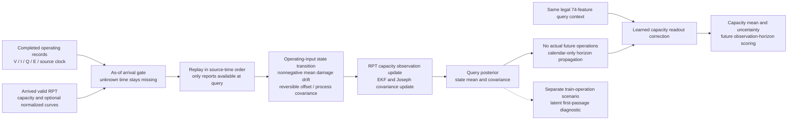
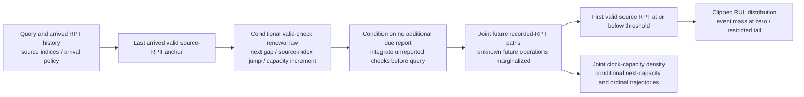

# Implemented mechanism and observation protocol

These branches are evaluated separately. An integrated A+B model has not been implemented.

A's damage drift is nonnegative in mean. Gaussian process noise and Bayesian corrections do not impose pathwise monotonicity. Capacity readout can bypass the latent state; its adjustment and state increments are recorded to test this failure mode. The latent first-passage diagnostic is not the source-observed RPT event target.

B2's second diagram is an implementation design under development, with no empirical claim. The model excludes administrative censor likelihood because stopping reasons remain unknown. Index gaps preserve invalid source slots. First-event labels refer to recorded valid RPTs and never assert a latent physical crossing. Fixed-gap and independent-marginal controls must be scored using the same target and horizon support.
